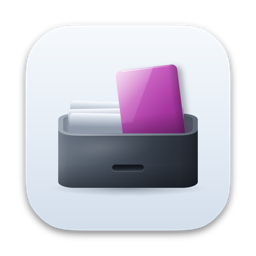
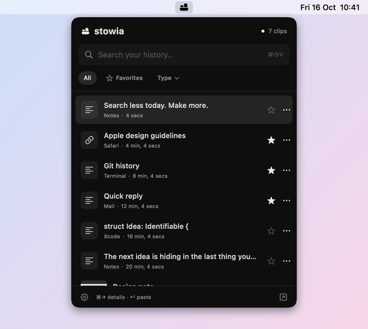

# Stowia

**A clipboard history that keeps everything you copy on your Mac, one shortcut away.**

[Website](https://hamzabasaran.com/stowia) · [Download Stowia.dmg](https://github.com/mehambas/stowia/releases/latest/download/Stowia.dmg) · [Changelog](CHANGELOG.md)

Stowia is where things get stowed: *stow*, to put away safely, and *-ia*, as in Arcadia. It remembers the text, links, images and files you copy. Press **⌘⇧V**, type a few letters and paste what you copied an hour or a week ago. The history never leaves your Mac.

<picture>
  <source media="(prefers-color-scheme: dark)" srcset="docs/images/demo-dark.gif">
  
</picture>

## Features

- **Quick panel** under the menu bar icon: **⌘⇧V**, type, **Return**. Stowia pastes into the app you were using, or only copies if you prefer to paste yourself.
- **Search** in the content, the names you give clips and the app they came from. Several words narrow the results, and accents need not be typed (`calisma` finds *çalışma*).
- **Text, links, images and files.** Rich text keeps its formatting, and **⇧Return** pastes it as plain text. Images get thumbnails and a preview. For files, Stowia keeps their location.
- **Favorites** stay until you delete them, whatever the history limits. Name a clip to find it by that name.
- **Library** window with a large preview, names, and actions such as Open in Browser, Show in Finder and Save Image.
- **Private.** Nothing leaves your Mac, and there is no telemetry. Content that password managers mark as concealed is never saved. 1Password, Bitwarden and Apple Passwords are excluded from the start, and you can exclude any app.
- Limits you choose: by default 30 days, 500 clips and 200 MB. Pause saving at any time.
- Native SwiftUI and AppKit, in English and Turkish. Apple silicon and Intel, macOS 14 or later.

## Install

1. Download [Stowia.dmg](https://github.com/mehambas/stowia/releases/latest/download/Stowia.dmg) from the [latest release](https://github.com/mehambas/stowia/releases/latest).
2. Open it and drag **Stowia** to **Applications**.
3. Eject the disk image and open Stowia from **Applications**, not from the disk image. Stowia is not notarized by Apple (that needs a paid developer account), so macOS blocks the first launch:
   - macOS says it could not verify Stowia. Click **Done**.
   - Open **System Settings › Privacy & Security**, scroll down to *“Stowia” was blocked*, click **Open Anyway** and confirm.

   On macOS 14 you can instead Control-click Stowia in Applications and choose **Open**. This is needed once per download.
4. Stowia lives in the menu bar. Press **⌘⇧V** or click its icon to open the panel. It saves what you copy from then on.
5. To paste with **Return**, Stowia needs Accessibility access: in the panel choose **⚙ › Settings…**, click **Allow Access…** under **Pasting** and turn on Stowia in **System Settings › Privacy & Security › Accessibility**. Without it, Return copies the clip and you paste with ⌘V.

To start Stowia when you log in, add it in **System Settings › General › Login Items**.

### Updates

Stowia checks for a new version once a day. When one is out, a dot appears on the ⚙ button in the panel, its menu starts with **Update to** and the version number, and **Settings › Updates** shows the release notes and **Download and Install**. That downloads the new disk image, verifies it and opens it, then Stowia quits: drag **Stowia** to **Applications** and replace the old version. **Check for Updates…** in the ⚙ menu checks right away.

## Usage

| Shortcut | Action |
| --- | --- |
| ⌘⇧V | Open or close the panel |
| ↑ / ↓ | Select a clip |
| Return | Paste into the previous app (copy without Accessibility access) |
| ⇧Return | Paste as plain text |
| ⌘→ | Show or hide the full content in the panel |
| ⌘, | Settings |
| Escape | Close |

Click a clip to paste it. The star adds it to your favorites; **•••** or a right-click copies it, copies it as plain text or deletes it. **All**, **Favorites** and **Type** filter the list. The ↗ button opens the library, where you can name clips and see them in full.

Some apps use ⌘⇧V to paste without formatting; while Stowia runs, ⌘⇧V opens Stowia instead, and ⇧Return pastes as plain text. If the shortcut can't be registered, the panel says so and the menu bar icon still opens it.

**Settings** (⚙ › Settings…):

- **History**: how long clips are kept, how many, and how much space they may take.
- **Pasting**: Accessibility access for pasting with Return.
- **Privacy**: apps whose copies are never saved, Clear Last Hour and Clear History. Clearing keeps your favorites.
- **Updates**: the daily check and Check Now.

## Privacy

- Stowia has no telemetry and sends nothing about you or your clipboard anywhere. Its only network request asks GitHub for the latest version number, once a day; turn it off with **Settings › Updates › Check for updates automatically**. An update is downloaded only when you click **Download and Install**.
- It skips everything that apps mark as concealed, transient or auto-generated ([nspasteboard.org](http://nspasteboard.org)), which is how password managers flag what they copy, and everything copied while an excluded app is in front. Apps that don't mark their secrets can still have them saved, so exclude them or pause saving.
- The history is in `~/Library/Application Support/Stowia`: `history.json` lists the clips, and one `.clip` file per clip holds what was copied. Only your user account can read them, and they are not encrypted beyond what FileVault does. For files, only their location is kept, not the files themselves.
- Settings are in `~/Library/Preferences/com.hamzabasaran.stowia.plist`.
- Stowia checks the clipboard every 0.65 seconds. What was on the clipboard before Stowia started, or was copied while saving was paused, is not saved.

## Uninstall

1. Quit Stowia: **⚙ › Quit Stowia** in the panel.
2. Move `/Applications/Stowia.app` to the Trash, and remove it from **Login Items** if you added it there.
3. Remove its history, settings and Accessibility permission:

   ```sh
   rm -rf ~/Library/Application\ Support/Stowia
   defaults delete com.hamzabasaran.stowia
   tccutil reset Accessibility com.hamzabasaran.stowia
   ```

## Build from source

You need macOS 14 or later and Xcode 16 or the Swift 6 command line tools. There are no other dependencies.

```sh
git clone https://github.com/mehambas/stowia.git
cd stowia
swift test --disable-sandbox
bash scripts/build.sh
open dist/Stowia.app
```

`scripts/build.sh` builds a universal app. It is signed ad hoc, so macOS asks for Accessibility access again after each rebuild; see [How Stowia works](docs/how-it-works.md#development) for a stable signature, the demo mode, the self-check and the release script.

## Support

Stowia is free and open source. If it saves you time, you can [buy me a coffee on Ko-fi](https://ko-fi.com/mehambas91) ☕

Found a bug or have an idea? [Open an issue](https://github.com/mehambas/stowia/issues).

## License

[MIT](LICENSE)
